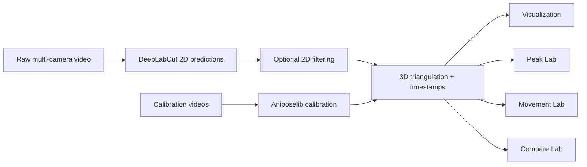

# Motion Pipeline GUI

A desktop GUI for a multi-stage **DeepLabCut + Aniposelib** motion-analysis workflow, built for synchronized multi-camera behavioral recordings.

The application wraps passive-video pose inference, camera calibration, 3D triangulation with timestamps, visualization, peak review, movement-window review, and cross-recording trace comparison in one PySide6 interface. Backend stages can use separate Python environments, so an existing lab-tested DeepLabCut environment and Aniposelib environment do not need to be merged.

**Current release:** `v0.5.7`

> **Lab/research software:** this repository contains analysis software only. Do not commit raw videos, animal/subject data, model outputs, or other sensitive research data. No open-source license has been selected yet; keep the repository private unless your lab/PI approves public release.

## What it does



### Pipeline stages

- **Passive Reading** — run an existing DeepLabCut model on selected recordings and optionally create filtered 2D variants.
- **Calibration** — calibrate synchronized cameras with Aniposelib/Charuco workflows.
- **Triangulation** — combine camera predictions into 3D coordinates and align them with source-video timing.
- **Visualization** — generate static and interactive traces/trajectories.

### Review labs

- **Peak Lab** — inspect X/Y/Z traces, clean signals, detect/review/move/remove peaks, preserve zoom state, save/reopen review sessions, and export event tables with 3D velocity.
- **Movement Lab** — review movement windows alongside synchronized raw video, seek ±5 seconds, change playback speed, and label movement intervals.
- **Compare Lab** — load traces from multiple recordings/conditions, reorder them, compare overlay/stacked layouts, hide controls, and export PNG/SVG/PDF/HTML figures.

### v0.5.7 highlights

- Multiple independent backend jobs can run concurrently in one GUI.
- Overall progress is shown above the console; active stages get temporary sidebar progress bars.
- Console can dock left, right, bottom, or float.
- Compare Lab control panel can collapse fully.
- Peak Lab and Movement Lab sections open expanded by default.
- Three shared plotting palettes: **Coral Grove**, **Orchid Dusk**, and **Aqua Current**.
- Dark theme uses `#212226`; light theme uses a clean white canvas with restrained accent colors.

See [CHANGELOG.md](CHANGELOG.md) for release details.

## Screenshots

Real workstation screenshots will be added after the v0.5.7 visual check. The repository is fully usable without them. See [`docs/SCREENSHOTS.md`](docs/SCREENSHOTS.md) for the exact captures requested for the README.

## Quick start

### 1. Clone the repository

```bash
git clone <YOUR-REPOSITORY-URL>
cd motion-pipeline-gui
```

### 2. Create the lightweight GUI environment

Python **3.11+** is recommended.

#### Conda

```bash
conda create -n motion-gui python=3.11 -y
conda activate motion-gui
python -m pip install --upgrade pip
python -m pip install -r requirements-gui.txt
```

Or create the same environment from the included file:

```bash
conda env create -f environment-gui.yml
conda activate motion-gui
```

### 3. Launch

```bash
python launcher.py
```

On Windows, after activating the GUI environment, you can also double-click/run:

```text
run_gui.bat
```

On macOS, see [docs/INSTALLATION.md](docs/INSTALLATION.md) or use `setup_macos.command` followed by `run_gui.command`.

## Backend environments

The GUI is intentionally separate from the heavy analysis environments.

You select the backend Python executable for each stage inside the GUI:

- **Passive Reading:** your working DeepLabCut environment
- **Calibration / Triangulation / Visualization:** your working Aniposelib environment

For a new machine, the files below document the minimum package families expected by the backend scripts:

- [`requirements-backend-dlc.txt`](requirements-backend-dlc.txt)
- [`requirements-backend-anipose.txt`](requirements-backend-anipose.txt)

If your lab already has tested DLC/PyTorch/Aniposelib environments, **prefer those known-good versions** rather than replacing them with generic latest packages.

Full setup notes: [docs/INSTALLATION.md](docs/INSTALLATION.md).

## Typical workflow

1. Select the trained DLC config and raw passive recordings.
2. Run **Passive Reading** to generate per-camera pose predictions.
3. Calibrate the camera system once for the relevant recording geometry.
4. Select the processed trial folder and calibration file in **Triangulation**.
5. Triangulate the desired data version (`raw`, median, ARIMA, Savitzky–Golay, Butterworth when available).
6. Inspect the 3D CSV in **Peak Lab**, **Movement Lab**, or **Compare Lab**.
7. Export reviewed event/timepoint tables and figures without overwriting the original 3D source CSV.

## Parallel jobs

v0.5.7 can launch multiple independent backend processes at once. Each job receives its own settings snapshot and tagged console stream.

This is process-level concurrency, not unlimited compute. Parallel jobs still share:

- CPU and RAM
- storage/network bandwidth
- GPU/VRAM
- destination files

Avoid running two jobs that write to the same output paths. Multiple DeepLabCut GPU jobs may compete for VRAM.

## Repository layout

```text
motion-pipeline-gui/
├── launcher.py
├── motion_gui/                 # PySide6 GUI, Peak/Movement/Compare Labs
├── backend/
│   ├── step_runner.py          # isolated backend launcher
│   └── scripts/                # DLC, calibration, triangulation, visualization
├── docs/                       # install, architecture, testing, screenshots, history
├── requirements-gui.txt
├── requirements-backend-dlc.txt
├── requirements-backend-anipose.txt
├── environment-gui.yml
├── run_gui.bat
├── run_gui.command
├── setup_macos.command
├── CHANGELOG.md
└── .github/                    # CI + issue template
```

## Testing

The current focused regression checklist is in [`docs/TESTING.md`](docs/TESTING.md).

GitHub Actions also runs a lightweight Python compile check on pushes and pull requests. This intentionally does **not** recreate the full DLC/Aniposelib GPU stack.

## Data and outputs

The repository `.gitignore` excludes common research data and generated artifacts such as videos, H5 predictions, NPY/MAT/CSV outputs, logs, Plotly HTML, and review-session files.

Keep actual recordings and processed datasets outside the repository.

## Versioning and releases

Releases use semantic-style tags such as:

```text
v0.5.7
```

The GitHub release should attach the distributable ZIP (`motion_pipeline_gui_v0.5.7.zip`) and use [`docs/RELEASE_NOTES_v0.5.7.md`](docs/RELEASE_NOTES_v0.5.7.md) as the release description.

## Documentation

- [Installation](docs/INSTALLATION.md)
- [Architecture](docs/ARCHITECTURE.md)
- [Testing](docs/TESTING.md)
- [v0.5.7 release notes](docs/RELEASE_NOTES_v0.5.7.md)
- [Screenshot checklist](docs/SCREENSHOTS.md)
- [Historical notes](docs/history/)

## Project status

v0.5.7 is the current pre-publication lab release. Calibration-camera inspection is intentionally deferred and is not part of this version.
